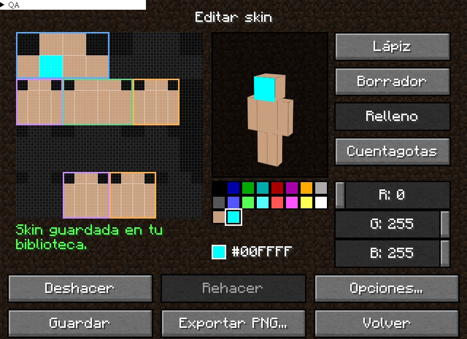

# Pruebas del editor y biblioteca de skins — 2026-10-18

## Resultado y correcciones

Se probaron las herramientas del editor, el historial, ambas capas, los modelos, el guardado y la reapertura. Se corrigieron estos problemas:

1. Cambiar solo el nombre o el modelo no activaba el aviso de cambios sin guardar. Ahora ambos forman parte del estado pendiente.
2. El relleno ignoraba el grupo corporal seleccionado. Ahora limita la cara al grupo y la capa activos, en classic y slim.
3. Un trazo o relleno sin cambios consumia historial y eliminaba los pasos de rehacer. El historial solo registra diferencias reales.
4. El guardado de una skin existente escribia los pixeles antes de validar el nombre y realizaba tres operaciones separadas. Ahora valida el documento antes de escribir y guarda pixeles y metadatos bajo el mismo bloqueo, con una sola actualizacion del indice.
5. Un error al abrir una skin dejaba una plantilla en blanco que podia sobrescribir el original. Ahora se bloquean dibujo, guardar y exportar hasta reabrir correctamente.
6. Pintar durante un guardado podia quedar marcado como guardado. Ahora se compara la revision enviada y se conservan los cambios posteriores como pendientes.
7. El campo de nombre movia la seleccion al recibir foco, interfiriendo con el reemplazo del texto. Se conserva el comportamiento de seleccion del campo nativo.
8. La vista 3D trataba los PNG antiguos 64x32 como 64x64. Ahora convierte la textura para la vista previa, sin modificar el PNG de la biblioteca. Descarta conversiones pendientes cuando cambia la skin.

Ademas, un trazo termina correctamente si se cancela el puntero o se pierde su captura.

## Pruebas de interfaz

Interfaz real de Svelte en el navegador de desarrollo, con API simulada y un arnes temporal para inspeccionar la textura y retener/fallar operaciones:

| Caso | Comprobacion |
| --- | --- |
| Lapiz y espejo | Los pixeles (8,8) y (15,8) recibieron RGBA [192,57,43,255]. |
| Borrador | Ambos pixeles reflejados quedaron transparentes. Deshacer restauro el color. |
| Cuentagotas y relleno | Recupero el color pintado y relleno los 64 pixeles de la cara frontal, conservando la capa exterior. |
| Capas | Base roja y exterior cian [85,255,255,255] conservaron sus valores tras guardar, salir y reabrir. |
| Historial sin cambios | Una pulsacion en una zona no editable despues de deshacer conservo Rehacer. |
| Dibujo con raton | Un arrastre pinto los ocho pixeles de una fila sin huecos. |
| RGB por teclado | Inicio/Fin en los canales produjo [0,255,255,255] y los 64 pixeles de la cara quedaron de ese color. |
| Nombre y modelo | Cambiar solo uno de ellos activo el dialogo al salir. Reemplazar el nombre no agrego texto al nombre anterior. |
| Guardado en curso | Se retuvo la respuesta, se pinto otro pixel y se libero el guardado. Salir mostro cambios pendientes. |
| Lectura fallida | PNG ilegible mostro el error y deshabilito Guardar y Guardar y exportar PNG. |
| Classic y slim | Cambio de modelo, guardado y reapertura; controles y seleccion consistentes. |
| Skin antigua | PNG 64x32 con brazo rojo y pierna verde: vista 3D 64x64 y miembros izquierdos del mismo color. Editar, guardar y reabrir preservo esos valores. |
| Biblioteca y perfil | Guardar no duplico la entrada existente; asignar al perfil actualizo el estado En uso. |
| Exportar en la UI | Se verifico la llamada y retorno del flujo; el dialogo del sistema no se automatizo. La exportacion fisica se comprobo por separado. |

Evidencia de pixeles: `review-assets/skins-qa-2026-10-18.json`.

Auditoria completa de pantallas: cero problemas a 820x560, 1100x720, 1920x1080 y GUI virtual 320x240 dentro de una ventana de 1100x720. Una ventana fisica de 320x240 queda por debajo del minimo nativo 820x560; a escala 1 sus botones de 20 px generan avisos de objetivo tactil pequeno, por lo que no equivale al caso de GUI virtual minimo.

## Datos reales y persistencia

Se hizo una copia de seguridad de `C:/Users/Pollito/AppData/Roaming/com.disorderlauncher.app/skins` en:

`C:/Users/Pollito/AppData/Local/Temp/DisorderLauncher-skins-backup-20261018-164433`

Con las dos skins reales se ejecuto el codigo Rust de SkinLibrary sobre el directorio real: importar una copia temporal, editar un pixel y el modelo, abrir otra instancia de la biblioteca y leer, rechazar un nombre invalido sin cambiar pixeles ni metadatos, escribir y volver a decodificar un PNG exportado y retirar la copia temporal. Se compararon los PNG originales byte por byte y la lista original completa al finalizar: intactos. Tambien se compararon los hashes SHA-256 del indice y de ambos PNG contra la copia de seguridad: los tres archivos son identicos. Los PNG de exportacion de prueba quedaron en el directorio temporal del sistema.

No se automatizaron clics de la ventana nativa: la captura fallo con `FrameArrived timed out` y la entrada por elementos devolvio `coordinate input geometry is unavailable`. Por eso se distinguen las pruebas de UI en navegador, con mock, de las pruebas de persistencia Rust con datos reales. El arnes y el ejecutable de prueba temporal se retiran del codigo entregado.

## Verificacion automatizada

- Frontend: 104 pruebas, incluidas regresiones de relleno restringido y preservacion de Rehacer.
- Rust: 98 pruebas aprobadas y 9 ignoradas en skins y launcher-core, incluidas validacion antes de guardar y 16 guardados concurrentes sobre el mismo recurso; la ultima version de pixeles, nombre y modelo debe pertenecer al mismo documento.
- Svelte/TypeScript: cero errores y cero advertencias. Clippy con advertencias como errores: aprobado. `git diff --check`: aprobado.
- Compilacion de produccion Tauri aprobada. Ejecutable actualizado: `target/release/disorderlauncher-desktop.exe`, 21 768 704 bytes, compilado el 18 de octubre a las 17:10 (hora local). SHA-256: `5AB1BF897BF9708FAC9EEC76692C68377AAA974A6000F577E83076CB63DC2BA5`.
- Se abrio ese ejecutable actualizado y se comprobo su menu principal mediante accesibilidad.

El bloqueo serializa las operaciones del editor; el PNG y el indice siguen siendo archivos distintos. Este cambio no introduce una transaccion de recuperacion ante cortes de energia entre ambas escrituras.
